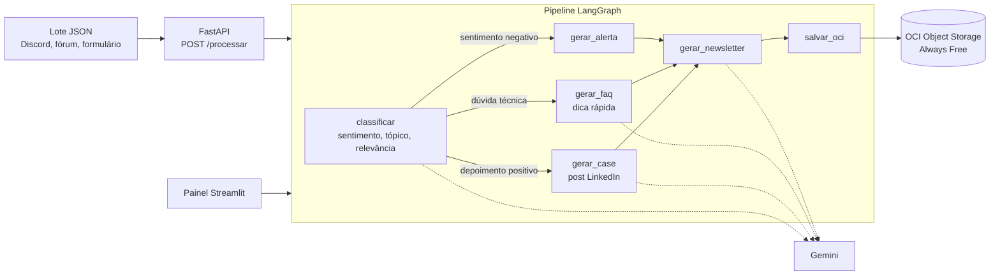

# CommunityLab

Motor inteligente que transforma a atividade de uma comunidade digital em ativos de marketing prontos para publicar: post de LinkedIn, destaque de newsletter, dicas de FAQ e alertas de membros que precisam de apoio.

Projeto do Hackathon ONE G10 (Oracle Next Education & Alura).

## Arquitetura



O roteador só abre os ramos que têm interações daquela rota no lote. Os ramos rodam em paralelo e se juntam na newsletter.

| Rota | Regra | Ativo gerado |
| --- | --- | --- |
| `case_sucesso` | depoimento ou projeto, sentimento positivo, relevância ≥ 7 | Post LinkedIn |
| `faq` | pergunta técnica | Dica rápida para mentoria |
| `alerta` | sentimento negativo ou reclamação | Alerta para o time de comunidade |
| todas | — | Destaque da newsletter semanal |

## Estrutura

| Caminho | O que é | Dono |
| --- | --- | --- |
| `app/schemas.py` | Contrato JSON de entrada e saída | Todos (mudanças combinadas) |
| `app/ia.py` (classificar), `app/prompts.py` (classificador) | Análise e regra de rota | Pessoa 1 · IA: análise |
| `app/ia.py` (gerar_*), `app/prompts.py` | Geração de conteúdo por canal | Pessoa 2 · IA: geração |
| `app/grafo.py`, `app/llm.py`, `app/main.py` | Orquestração, retry e API | Pessoa 3 · Backend |
| `ui/painel.py` | Painel de curadoria Streamlit | Pessoa 4 · Interface |
| `app/storage.py` | Upload OCI e deploy | Pessoa 5 · Cloud OCI |
| `data/`, `tests/` | Dataset e testes | Pessoa 6 · Dados e qualidade |
| `docs/`, `README.md` | Diferenciais, documentação e demo | Pessoa 7 · Diferenciais |

## Como rodar

```bash
python -m venv .venv
source .venv/bin/activate        # Windows: .venv\Scripts\activate
pip install -r requirements.txt
cp .env.example .env              # preencha as chaves
```

Sem chaves, tudo roda em **modo simulado**: o LLM devolve respostas por regra e os pacotes vão para `saida_local/`. Assim dá para desenvolver sem gastar cota.

```bash
pytest                                  # testes
uvicorn app.main:app --reload           # API em http://localhost:8000/docs
streamlit run ui/painel.py              # painel
```

Exemplo de chamada à API:

```bash
curl -X POST http://localhost:8000/processar \
     -H "Content-Type: application/json" \
     -d @data/interacoes_exemplo.json
```

## Configurando o Gemini

1. Gere uma chave em [Google AI Studio](https://aistudio.google.com/apikey).
2. Coloque em `GEMINI_API_KEY` no `.env`.
3. `GET /saude` deve responder `"modo_llm": "gemini"`.

## Configurando o OCI Object Storage (Always Free)

1. Crie a conta em [oracle.com/cloud/free](https://www.oracle.com/cloud/free/).
2. No console, crie o bucket `communitylab-ativos-marketing` (Storage → Buckets).
3. Em Perfil → API Keys, gere uma chave e salve o trecho de configuração em `~/.oci/config`.
4. Copie o **namespace** (aparece nos detalhes do bucket) para `OCI_NAMESPACE` no `.env`.
5. Rode um lote: o campo `armazenamento_oci.status` deve vir `salvo_com_sucesso`.

Use **somente recursos Always Free**. O Object Storage gratuito tem limite de armazenamento; pacotes JSON ocupam poucos KB.

## Próximos passos por pessoa

- **Pessoa 1:** testar o classificador real no dataset rotulado e medir acertos.
- **Pessoa 2:** ajustar os prompts com a voz da marca e impedir fatos inventados.
- **Pessoa 3:** ligar o Gemini, tratar JSON inválido e limite de requisições.
- **Pessoa 4:** filtros, exportação dos aprovados e gráfico de tópicos no painel.
- **Pessoa 5:** criar conta e bucket OCI, testar o upload real e preparar a VM Always Free.
- **Pessoa 6:** ampliar o dataset para 40 a 60 mensagens com a rota esperada e cobrir as 4 rotas nos testes.
- **Pessoa 7:** webhook do Discord, card de imagem, README final e roteiro da demo.
