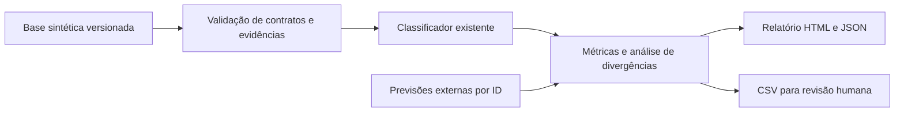

# Avaliação das classificações

A avaliação compara o classificador existente com referências explícitas de tipo, sentimento, relevância e rota. Sua finalidade é localizar erros, documentar critérios e tornar a qualidade verificável. O classificador, os prompts, o contrato da API, a interface e o armazenamento permanecem sob responsabilidade de suas respectivas frentes.

## Escopo e situação da entrega

O conjunto `data/avaliacao_classificacoes.json`, versão 1.1.0, contém 60 mensagens sintéticas: dez por tipo, distribuídas entre 48 casos de referência e 12 desafios. Cada caso possui ID, evidência literal, justificativa, faixa de relevância e sinalização histórica de prioridade de revisão. Everson concluiu a **revisão individual de propostas em 24/10/2026**, aceitando os 60 casos, suas classificações, intervalos, justificativas e os critérios sem alterações. Esse método não equivale a dupla anotação independente nem mede concordância entre revisores.

Os critérios semânticos estão em [Critérios de qualidade](criterios_qualidade.md). Os resultados medidos e suas implicações estão em [Análise dos resultados](analise_resultados.md).



A execução chama `app.ia.classificar` por mensagem. Não chama `app.grafo.processar`, não gera ativos, não publica conteúdo e não grava no OCI.

## Reprodução local

Na raiz do checkout, com Python 3.10 ou superior e o ambiente virtual do projeto ativado:

```powershell
python -m pip install -r requirements.txt
python scripts/avaliar_classificacoes.py
python scripts/avaliar_classificacoes.py --cenario tipo_informado
python -m pytest -q -m "not real"
```

O primeiro comando de avaliação usa `--modo mock --cenario tipo_oculto`. A chave Gemini, se existir no ambiente, não é utilizada nesse modo. `LLM_MODO` é restaurado ao final. A avaliação usa as dependências existentes; não requer bibliotecas adicionais de métricas ou visualização. A seleção de testes `-m "not real"` exclui os testes que dependem de serviços externos; essas integrações devem ser validadas separadamente.

Os relatórios ficam em:

```text
data/output/avaliacao/mock_tipo_oculto/relatorio.html
data/output/avaliacao/mock_tipo_informado/relatorio.html
```

Abra os arquivos HTML no navegador; não é necessário servidor, internet, CDN ou extensão. `--saida` permite escolher outra pasta base. Uma nova execução substitui os arquivos da mesma combinação de modo e cenário; preserve resultados de versões diferentes em pastas distintas.

### Dois cenários com interpretações diferentes

| Cenário | Entrada enviada ao classificador | Interpretação |
| --- | --- | --- |
| `tipo_oculto` | `tipo="outro"` em todos os casos | Avalia a inferência a partir do texto e do canal. É o cenário principal. |
| `tipo_informado` | Tipo anotado preservado | Avalia o fluxo assistido por metadados. O mock reaproveita esse campo; acurácia alta de tipo não demonstra classificação autônoma. |

O classificador real atual envia canal e texto ao LLM; o tipo informado não integra seu prompt. Esse detalhe deve ser reavaliado se a implementação mudar. Os dois cenários compartilham exatamente os mesmos textos e referências; o avaliador não modifica a base em memória.

### Saídas

| Arquivo | Uso |
| --- | --- |
| `relatorio.html` | Visão da amostra, métricas, matrizes, metas da avaliação e casos rastreáveis. |
| `resultado.json` | Resultado completo, recortes, hashes da base e código, estado da revisão, modo e cenário efetivos. |
| `metricas_por_categoria.csv` | Suporte, precisão, recall e F1 por classe e dimensão. |
| `matriz_confusao_tipo.csv` | Tipo esperado por tipo previsto. |
| `matriz_confusao_sentimento.csv` | Sentimento esperado por sentimento previsto. |
| `matriz_confusao_rota.csv` | Rota esperada por rota prevista. |
| `revisao_classificacoes.csv` | Todos os casos priorizados, com estado da revisão, rótulos confirmados, revisor, data e campos para futuras correções. |

Os CSVs usam UTF-8 com BOM, delimitador vírgula e proteção contra interpretação de células textuais como fórmulas. Em planilhas com configuração regional brasileira, importe escolhendo UTF-8 e vírgula. Os resultados gerados ficam fora do versionamento, conforme a convenção `data/output/` do projeto. O código, a base, os critérios e a análise técnica são versionados.

## Definição das métricas

As métricas são calculadas independentemente para tipo, sentimento e rota. Nas matrizes, **linhas são referências; colunas são previsões**. A última coluna contém classificações ausentes, inválidas ou indisponíveis.

- Precisão da classe: `TP / (TP + FP)`. Sem previsões daquela classe, o valor é indefinido (`null` no JSON, célula vazia no CSV).
- Recall da classe: `TP / (TP + FN)`. Uma falha de execução conta como falso negativo da classe esperada. Sem referências da classe, recall é indefinido.
- F1 da classe: `2 TP / (suporte + preditos)`. É zero quando há referência ou previsão sem acerto; é indefinido se ambos os suportes são zero.
- Macro-F1: média dos F1 das classes **com suporte de referência**. O relatório preserva as classes ausentes, e o critério de cobertura do vocabulário impede considerar sua ausência como evidência de qualidade.
- F1 ponderado: média dos F1 ponderada pelo suporte de referência.
- Acurácia: acertos divididos pelo **total de casos**, incluindo falhas.
- Cobertura: previsões estruturalmente válidas divididas pelo total de casos.

O suporte é indispensável: um recall de 100% em dois exemplos não demonstra robustez. Não há intervalo de confiança populacional, porque a amostra é pequena, sintética e selecionada por cobertura de cenários, sem amostragem probabilística.

### Relevância e tópico

A relevância é uma pontuação editorial de 0 a 10, não uma medida de urgência ou de satisfação. Em vez de impor um ponto arbitrário como verdade, cada caso tem um intervalo aceitável. A proporção dentro da faixa divide os acertos pelo total, incluindo falhas; a distância média à faixa usa somente previsões válidas, com denominador explícito. Distância zero indica valor dentro do intervalo.

`topico` é texto livre e não recebe acurácia por igualdade exata. O relatório conta textos idênticos, sem afirmar agrupamento semântico ou detecção de dúvidas recorrentes. A revisão qualitativa verifica se o tópico descreve o assunto, é específico e encontra apoio na mensagem. No mock, o tópico vem do nome do canal.

### Metas da avaliação e recortes

As metas de macro-F1, recall de alerta e relevância usam somente os 48 casos do grupo `referencia`. O relatório também mostra as métricas dos 60 casos e do grupo `desafio`; esses desafios não são removidos silenciosamente nem usados para inflar os indicadores principais.

As metas numéricas foram aprovadas por Everson em 24/10/2026 como responsável pela frente analítica. Não representam aprovação de toda a equipe, exigências dos avaliadores do hackathon ou resultados já alcançados. Além dos limites descritos na rubrica, exige-se cobertura completa do vocabulário no recorte de referência e 100% de coerência entre a rota prevista e a regra oficial. A coerência de rota verifica uma propriedade diferente do acerto semântico: uma rota pode seguir a regra e continuar errada por receber um sentimento incorreto.

```powershell
python scripts/avaliar_classificacoes.py --exigir-metas
```

Códigos de saída: `0` para execução completa; `1` para alguma previsão ausente/inválida, ou meta não atendida quando `--exigir-metas` é usado; `2` para configuração ou entrada inválida. O mock pode executar corretamente e falhar nas metas de qualidade. Um código `0` nunca equivale a aprovação humana ou liberação para produção.

## Avaliação de previsões existentes

Para resultados produzidos por outro processo, use um arquivo com este envelope:

```json
{
  "dataset_sha256": "SHA256 completo do arquivo da base utilizada",
  "cenario": "tipo_oculto",
  "modelo": "identificador declarado pelo responsável pela execução",
  "previsoes": [
    {
      "id": "AV001",
      "analise": {
        "autor": "mesmo autor do caso",
        "canal": "mesmo canal do caso",
        "texto": "mesmo texto do caso",
        "tipo": "depoimento",
        "sentimento": "Altamente Positivo",
        "topico": "Assunto da mensagem",
        "relevancia": 9,
        "rota": "case_sucesso"
      }
    }
  ]
}
```

O trecho ilustra o contrato; substitua os valores pelos resultados reais. Calcule o hash no PowerShell com `(Get-FileHash data/avaliacao_classificacoes.json -Algorithm SHA256).Hash.ToLower()`, ou consulte `metadados.dataset_sha256` no relatório da mesma base.

```powershell
python scripts/avaliar_classificacoes.py --modo arquivo --previsoes caminho/previsoes.json
```

IDs devem ser únicos e conhecidos. A ordem das previsões é irrelevante. IDs ausentes contam como falhas; IDs desconhecidos ou duplicados invalidam o arquivo. Autor, canal e texto da previsão precisam coincidir exatamente com a interação correspondente. O hash identifica os bytes do arquivo, inclusive sua codificação e quebras de linha.

O modo permanece `arquivo`, mesmo se o campo `modelo` disser Gemini. A origem do modelo é declarada, não verificada. Isso evita apresentar um resultado importado como evidência de uma chamada externa que o avaliador não realizou.

Os metadados registram o horário UTC da importação, que não equivale ao horário da execução original. Rodadas Gemini registram o início em UTC. O modo mock preserva saídas determinísticas, identificadas por versão, cenário e hashes, sem inserir um timestamp variável. A versão de Pydantic também é registrada para rastrear a validação do contrato.

## Execução real com Gemini

A avaliação local entregue usa somente mock. Para uma execução real autorizada, configure `GEMINI_API_KEY` no ambiente e, opcionalmente, `GEMINI_MODELO` antes de iniciar o processo:

```powershell
python scripts/avaliar_classificacoes.py --modo gemini
```

Esse comando envia as 60 mensagens ao provedor e consome sua cota, com as tentativas configuradas em `app/llm.py`. Não lê `.env` automaticamente. Sem chave não executa e não substitui silenciosamente Gemini por mock. Não registra a chave. Erros por mensagem ficam no relatório com a classe da exceção, sem copiar conteúdo de respostas de erro do provedor.

A temperatura e o modelo do pipeline podem produzir resultados distintos entre execuções. Compare somente execuções com base, cenário, código e configuração compatíveis, registrando modelo e resultados. A validação real de Gemini e de OCI pertence à integração do projeto e não está demonstrada pelos resultados mock.

## Revisão e manutenção

Todos os 60 casos da base 1.1.0 têm revisão individual registrada. A fila continua colocando falhas e alertas não detectados em prioridade alta; depois vêm divergências e situações ambíguas. Essa prioridade orienta a inspeção das previsões e não altera o estado de revisão das referências nem implementa uma regra de atendimento da comunidade.

O CSV reúne referências, previsões e campos de revisão. Para a base revisada, `status_revisao` é exportado como `confirmado`, com os rótulos e intervalos aceitos em `*_revisado`, `revisor`, `data_revisao` e a observação da decisão registrada. Em uma base legada pendente, `status_revisao` permanece `pendente`, e os campos de decisão ficam vazios. Uma concordância do classificador com a referência não gera aprovação humana automaticamente.

Na raiz da base, `status_anotacao` identifica a situação atual, e `revisao_anotacao` registra `revisor`, `data`, `metodo`, `decisao`, `escopo`, `versao_criterios`, `versao_origem`, `dataset_origem_sha256`, `casos_sha256` e `casos_revisados`. A versão de origem é 1.0.0, e a rubrica permanece em 1.0.0. Os hashes identificam a base recebida para revisão e o conteúdo dos casos aceitos; os IDs registram os 60 casos abrangidos. A versão 1.1.0 acrescenta esse registro, sem mudar mensagens, classificações, intervalos ou justificativas. A sinalização `revisao_humana` em cada caso preserva a prioridade histórica de revisão e não representa aprovação ou pendência atual.

Na conferência individual de propostas, o revisor lê cada mensagem e a rubrica, verifica a classificação proposta e registra concordância, correção ou dúvida, sem usar a previsão do classificador como gabarito. Registre também as concordâncias, para distingui-las de casos ainda não lidos. Esse método deve ser identificado como revisão individual de propostas, sem alegar anotação independente ou concordância entre revisores. Uma ficha simplificada pode coletar decisões por ID; sua consolidação precisa preservar a versão da base, os rótulos aceitos, o revisor, a data e a justificativa das alterações.

Para uma dupla anotação independente, as pessoas devem decidir usando mensagem e rubrica antes de consultar propostas ou previsões. Divergências entre revisores precisam de adjudicação documentada. A dupla revisão é um reforço metodológico, não uma condição para compartilhar a implementação ou registrar uma revisão individual. O CSV é um instrumento de coleta: sua edição não muda automaticamente a base nem sinaliza aprovação no pipeline.

Uma alteração aceita nas referências exige atualizar a base versionada, sua versão, a justificativa, o registro de revisão e a análise; depois, executar os testes e gerar novos resultados. Casos alterados ou acrescentados não herdam automaticamente a aprovação da versão anterior: exigem nova conferência. Preserve a versão anterior para comparação. Não ajuste referências apenas para aumentar a pontuação do mock. Ao usar os exemplos para orientar prompts, eles passam a ser desenvolvimento/regressão; a validação de generalização requer um conjunto independente ainda não usado nos ajustes.
